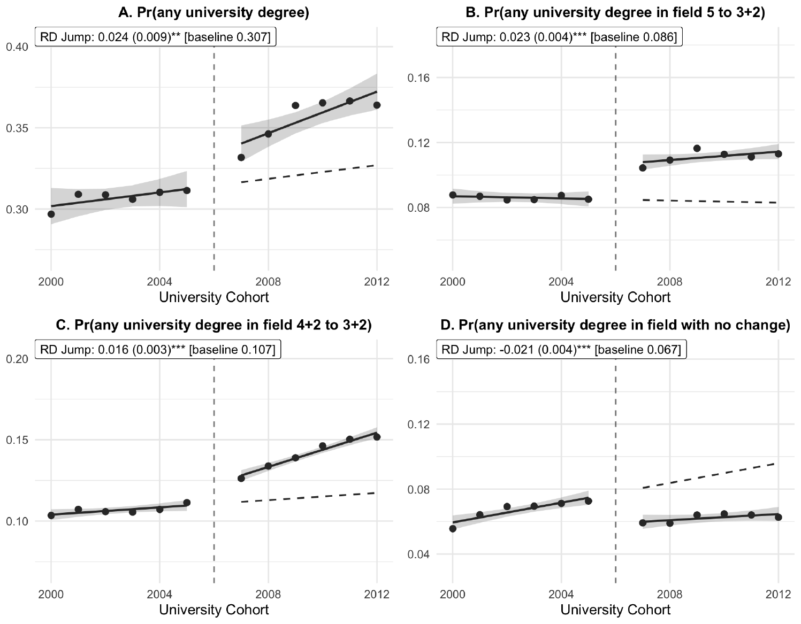
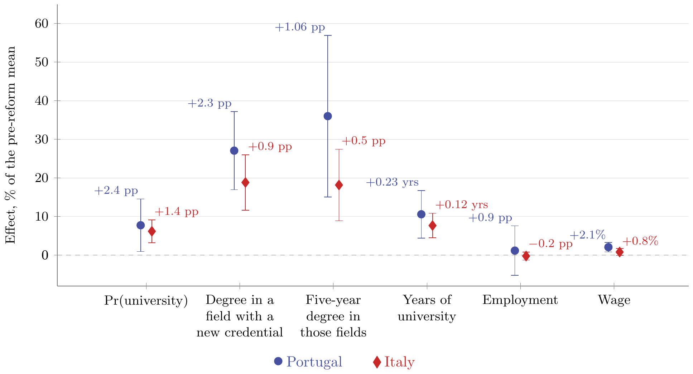
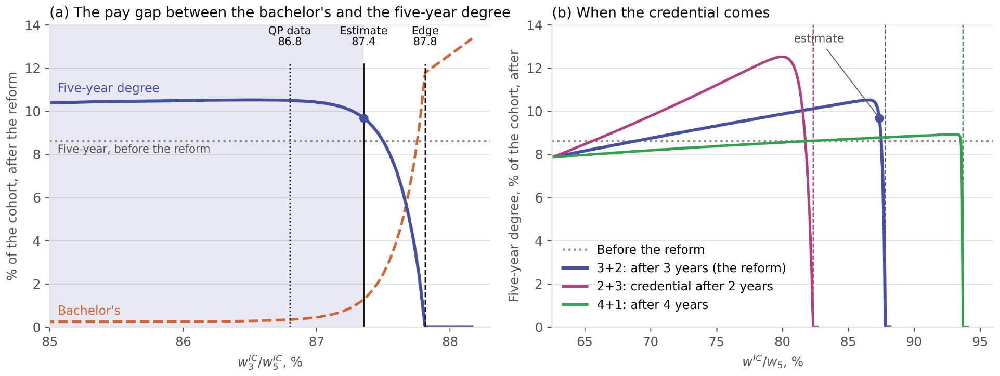

## What changed

Portugal’s Bologna reform changed how long students had to study before earning their first qualification. In fields such as economics, it shortened the first degree from four years to three. In fields such as engineering, it added a bachelor’s after three years within an existing five-year programme. Students could leave with a qualification or stay for the master’s. The second change made it less risky to try a field before knowing whether it suited them.

I compare cohorts that reached university age just before and after the reform, using a regression discontinuity design. The first fully exposed Portuguese cohort turned 18 in 2007. I use Portugal’s linked employer–employee records to measure degrees, jobs and wages, and household surveys to measure enrolment and dropout and check the education results.

## What I find

**More people tried university, and more graduated.** In the Education and Training Survey, enrolment rose by 6.2 percentage points and the share who had left a degree unfinished rose by 2.6 points. Completion rose by 3.6 points in that survey and by 2.4 points in the linked employer–employee records. Average time at university rose by 0.23 years, or 11%, counting zero years for people without a university degree.

{fig-alt="Two cohort plots show enrolment rising by 6.2 percentage points and dropout rising by 2.6 points at the reform cutoff."}

**Graduates shifted towards fields that Bologna changed.** The share of the cohort holding a degree rose by 2.3 percentage points in fields that added an intermediate qualification and by 1.6 points in fields that shortened their first degree. It fell by 2.1 points in fields that kept their previous structure, with the largest decline in nursing. These shifts carried over into jobs in engineering and health.

{fig-alt="Four cohort plots compare completion overall, in fields with a new intermediate qualification, in fields with a shorter first degree, and in fields left unchanged."}

{fig-alt="Bar chart showing gains in engineering degree completion, engineering occupations and engineering sectors, alongside declines across the corresponding health outcomes."}

**More people completed the full five years in engineering.** The share of the cohort holding a five-year engineering degree rose by 1.1 percentage points from a baseline of 2.9%. The share working in engineering occupations that require the full qualification rose by 0.7 points.

{fig-alt="Two cohort plots show increases in five-year engineering degrees and in employment in engineering occupations requiring that qualification."}

**Hourly wages rose, and cumulative earnings caught up around age 30.** Hourly wages at ages 28 to 30 rose by 2.1%. Sorting into higher-paying firms accounted for 46% of the gain, and there was no clear change in employment. Post-reform cohorts had earned about €4,900 less by age 25 as more of them stayed in education. The gap closed around age 30, and by age 32 their estimated cumulative earnings were higher.

{fig-alt="Two cohort plots show average years of university rising by 0.23 years and hourly wages rising by 2.1 percent."}

{fig-alt="The estimated cumulative earnings gap reaches about minus 4,900 euros at age 25 and closes around age 30."}

Italy implemented Bologna earlier and shows a similar pattern. University completion rose by 6%, average time at university rose by 8%, and five-year completion also increased in fields that gained an intermediate qualification.

{fig-alt="Point estimates and confidence intervals compare university completion, degrees in reformed fields, five-year degrees, years of university, employment and wages in Portugal and Italy."}

## Why five-year completion rose

In the model, students learn how well a programme suits them as they study. An intermediate qualification gives them a reason to try a longer programme even when they are unsure they will finish. The model estimates that new five-year graduates accounted for about 1.5 percentage points of the cohort. Around 40% of those graduates would otherwise have skipped university, and 60% would have studied another field. The model also estimates that about 0.5 percentage points of the cohort would previously have finished the five-year degree but now stopped at three years or completed a degree in another field. The net gain was about one percentage point.

The model suggests that an intermediate qualification can raise full-degree completion when it comes early enough to make enrolling less risky and the full degree still offers a meaningful wage gain.

{fig-alt="The first panel varies the bachelor’s wage relative to five-year pay. The second compares intermediate qualifications after two, three and four years."}
