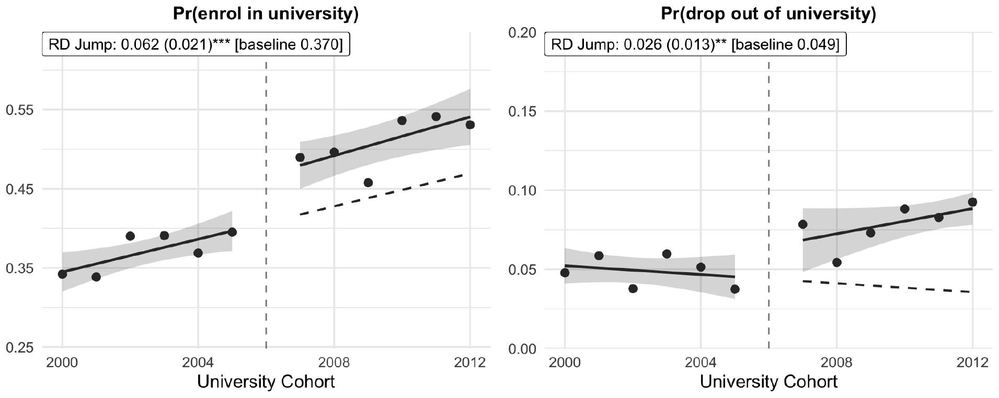
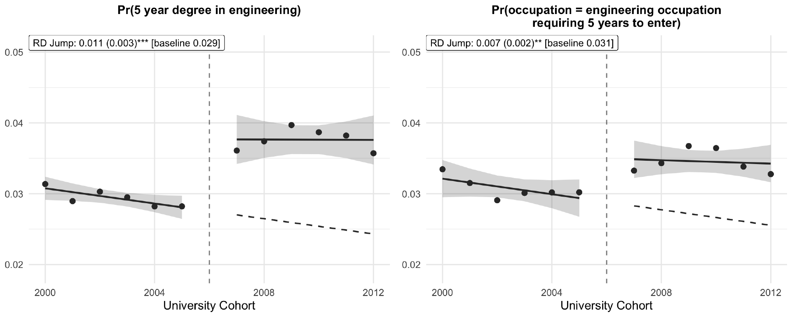
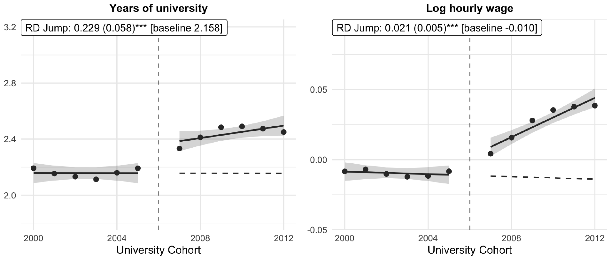
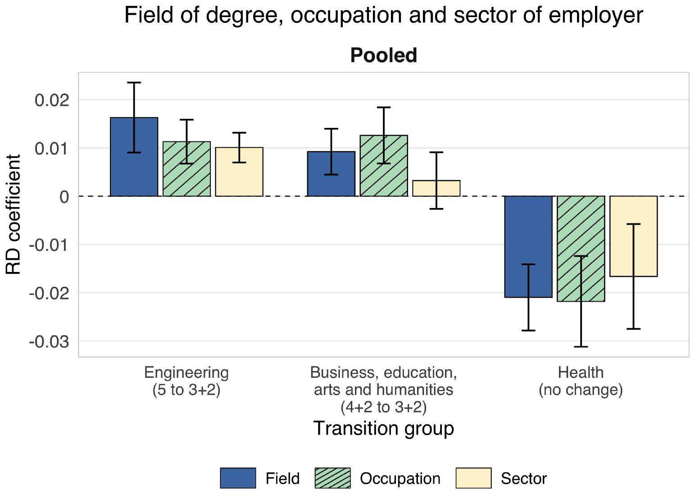
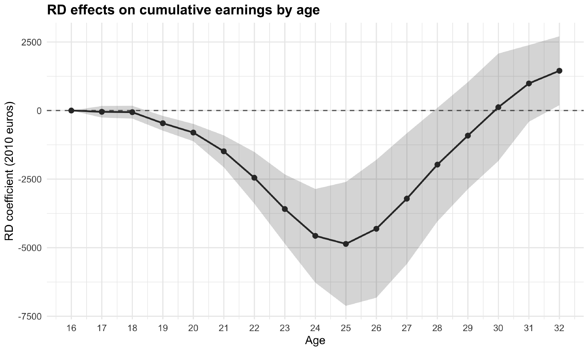

## Abstract

Making university degrees shorter or adding intermediate credentials can be effective tools to increase university participation. However, a short degree provides less training and an intermediate credential may induce students who would have otherwise completed the full degree to stop early. Understanding how students navigate these trade-offs is important for the design of higher-education systems. I study this using the Bologna Process as a natural experiment. Using a regression discontinuity across birth cohorts and linked employer–employee data from Portugal, I find that shorter degrees and intermediate credentials increase university attainment by 8%, average years of university by 0.23 years, and hourly wages by 2.1%. More strikingly, I find that adding an intermediate credential inside a five-year degree increases the share of people completing the full five years. A simple and intuitive dynamic model in which students learn about their match quality while studying is consistent with these results.

### Research question

Long degrees are risky. Students bear tuition and foregone earnings from the start, but learn only gradually whether they are well matched to their field, and much of the payoff arrives only if they graduate. The Bologna Process changed that investment in two distinct ways: it shortened some existing bachelor's degrees from four years to three, and it inserted a three-year bachelor's into fields that had previously offered only a single five-year degree.

The first change lowered the cost of obtaining a first degree. The second created an earlier exit with a recognised qualification, reducing the downside of trying a field under uncertainty. The paper asks whether these changes drew more students into university, whether students stopped at the new bachelor's or continued to a master's, how their choice of field changed, and how those choices affected later earnings.

### Setting and empirical design

Portugal implemented the Bologna structure rapidly in 2006--07. Because most students enter university at 18, cohorts turning 18 in 2007 or later made their choices under the new system. I use a regression discontinuity design that compares birth cohorts on either side of this cutoff, excluding the partly treated 2006 cohort.

Italy provides a second setting. Its reform took effect six years earlier and students typically enter university at 19. Finding similar changes at a different cutoff helps distinguish the effect of Bologna from other conditions affecting Portuguese cohorts in 2007.

### Data

The main analysis uses *Quadros de Pessoal*, Portugal's linked employer--employee data for the private sector. It records workers' education, field of study, wages, occupations, job titles and employers, making it possible to follow the reform from university choices into jobs and to estimate the wage premium paid by each firm. I validate the education results using the Portuguese Labour Force Survey and the Education and Training Survey, both of which represent the wider resident population. The Italian Labour Force Survey provides the cross-country comparison.

### Main findings

**More people enrol in university, and dropout also rises.** In the Education and Training Survey, the share who had ever enrolled rose by 6.2 percentage points, or 17%. The share who had ever left a university degree unfinished rose by 2.6 points. Enrolment rose more than dropout, and completion in the same survey rose by 3.6 points.

{fig-alt="Two cohort plots show enrolment rising by 6.2 percentage points and dropout rising by 2.6 points at the reform cutoff."}

**University completion rises, and graduates shift towards fields Bologna changed.** In *Quadros de Pessoal*, university completion rises by 2.4 percentage points, or 8%. Degree completion rises by 2.3 points in fields that gained a three-year exit, mainly engineering, architecture and computing, and by 1.6 points in fields where the first degree became shorter. It falls by 2.1 points in fields left unchanged, with the largest decline in nursing.

{fig-alt="Four cohort plots show degree completion rising overall and in the two groups of reformed fields, and falling in fields left unchanged."}

**The new exit does not simply lead students to stop after three years.** The share of the cohort earning a five-year engineering degree rises by 1.1 percentage points from a baseline of 2.9%. Employment in engineering occupations that require the full five-year qualification rises by 0.7 percentage points from a baseline of 3.1%. The reform made engineering less risky to try; some of the additional students then discovered that they were well matched and continued through the master's.

{fig-alt="Two cohort plots show increases in five-year engineering degrees and in employment in engineering occupations requiring that qualification."}

**Average years of university and hourly wages both rise.** Average years of university increase by 0.23 years, or 11%, counting zero for people without a university degree. Hourly wages at ages 28 to 30 are 2.1% higher for post-reform cohorts.

{fig-alt="Two cohort plots show average years of university rising by 0.23 years and hourly wages rising by 2.1 percent."}

The wage decomposition in Table 1 attributes 46% of the gain to sorting into higher-paying firms. The estimated wage gains are 2.5% for women and 1.5% for men.

**The shift in degree fields carries over into jobs.** The shares holding an engineering-related degree, working in a related occupation, and working in a related sector all rise. All three measures fall for health. In business, education, arts and humanities, degrees and employment in related occupations rise, with little evidence of a change in employment in the related sectors.

{fig-alt="Engineering rises and health falls across all three measures. In business, education, arts and humanities, the increase is clearest for degrees and occupations."}

**Early earnings losses are recovered by the early thirties.** Post-reform cohorts enter work later and earn less cumulatively through their twenties. The gap is largest at age 25, at about €4,900. It closes around age 30, and by age 32 the estimated difference is positive.

{fig-alt="The estimated cumulative earnings gap reaches about minus 4,900 euros at age 25 and closes around age 30."}

### External validity

Italy shows the same broad pattern around a reform introduced six years earlier. University completion rises by 1.4 percentage points, or 6%, and years of university rise by 8%. In both countries, more people earn degrees in fields that gained an intermediate credential, including full five-year degrees. There is no clear change in employment in either country. Estimated wages rise by 2.1% in Portugal, measured hourly, and by 0.8% in Italy, measured using net monthly pay.

{fig-alt="Point estimates and confidence intervals compare university completion, degrees in fields with a new credential, five-year degrees in those fields, years of university, employment and wages in Portugal and Italy."}

### Takeaway

An earlier credential makes a longer programme less risky to try. In the simulations on the left, a better-paying three-year bachelor’s initially draws in more students who finish five years. When bachelor’s pay gets close enough to five-year pay, more students choose to stop at three years. The right panel compares a credential after two, three or four years. An earlier credential gives more students a fallback. It also takes a larger wage gain from the full degree to keep them studying.

{fig-alt="In the left panel, five-year completion rises initially and then drops as bachelor’s pay approaches five-year pay. In the right panel, an earlier credential reaches that drop at a lower relative pay."}
