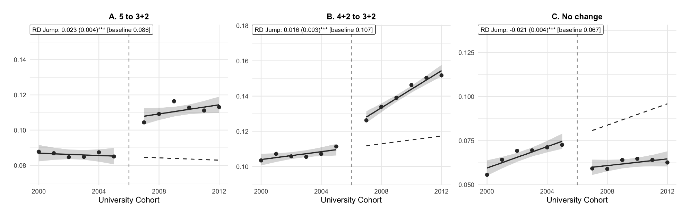
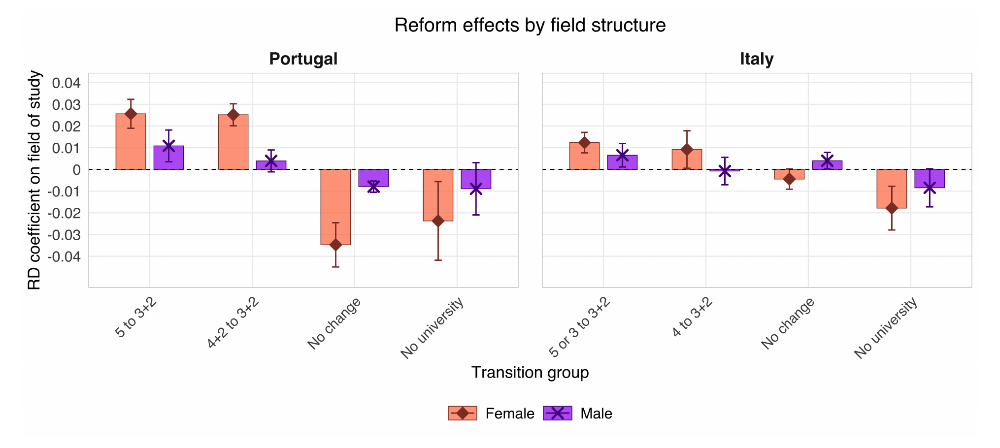

## Abstract

Higher-education systems differ in the length and flexibility of their degrees. A shorter first degree lowers the cost of a qualification but may mean less training. Making a long degree more flexible by splitting it into a bachelor's and a master's leaves students less to lose if university does not suit them, but may lead some who would have finished to stop at the bachelor's. I study these trade-offs using the Bologna Process as a large-scale natural experiment. In fields that already had a bachelor's and a master's, it shortened the bachelor's. In fields with a single long degree, it introduced a bachelor's credential partway through, making the degree more flexible. Using a regression discontinuity across birth cohorts and linked employer--employee data from Portugal, I find that this flexibility increased, rather than reduced, the share completing the full degree. Overall, the reform raised university completion by 2.4 percentage points (8%), time spent at university by 0.23 years, and hourly wages at ages 28 to 30 by 2.1%, with larger gains for women. Students shifted towards both types of reformed field and away from unchanged fields, with corresponding shifts in their sectors and occupations. A dynamic discrete-choice model in which students learn whether university suits them explains the central finding: flexibility attracts students who are less certain they will succeed, some of whom discover that they are well matched and complete the full degree. Counterfactuals show that whether an intermediate bachelor's raises full-degree completion depends on when it is awarded and how much it pays relative to the full degree.

### Research question

Long degrees are risky. Students bear tuition and foregone earnings from the start, but learn only gradually whether they are well matched to their field, and much of the payoff arrives only if they graduate. The Bologna Process changed that investment in two distinct ways: it shortened some existing bachelor's degrees from four years to three, and it inserted a three-year bachelor's into fields that had previously offered only a single five-year degree.

The first change lowered the cost of obtaining a first degree. The second created an earlier exit with a recognised qualification, reducing the downside of trying a field under uncertainty. The paper asks whether these changes drew more students into university, whether students stopped at the new bachelor's or continued to a master's, how their choice of field changed, and how those choices affected later earnings.

### Setting and empirical design

Portugal implemented the Bologna structure rapidly in 2006--07. Because most students enter university at 18, cohorts turning 18 in 2007 or later made their choices under the new system. I use a regression discontinuity design that compares birth cohorts on either side of this cutoff, excluding the partly treated 2006 cohort.

Italy provides a second setting. Its reform took effect six years earlier and students typically enter university at 19. Finding similar changes at a different cutoff helps distinguish the effect of Bologna from other conditions affecting Portuguese cohorts in 2007.

### Data

The main analysis uses *Quadros de Pessoal*, Portugal's linked employer--employee data for the private sector. It records workers' education, field of study, wages, occupations, job titles and employers, making it possible to follow the reform from university choices into jobs and to estimate the wage premium paid by each firm. I validate the education results using the Portuguese Labour Force Survey and the Education and Training Survey, both of which represent the wider resident population. The Italian Labour Force Survey provides the cross-country comparison.

### Main findings

**More students complete university, and total schooling rises.** University completion increases by 2.4 percentage points, or 8% of the pre-reform mean. Average years of university rise by 0.23 years, or 11%, so the schooling added by new graduates more than offsets any reduction among students who finish earlier. The gains are larger for women.

**Students move towards fields where Bologna changed the first credential.** Degrees in fields that gained a three-year exit---mostly engineering, architecture and computing---rise by 2.3 percentage points, or 26% of their pre-reform mean. Degrees in fields where the first degree became shorter rise by 1.6 percentage points, or 15%. Degrees in unchanged fields fall by 2.1 percentage points, or about 30%, driven by health, where nursing remained a four-year degree. These shifts are substantially larger for women.

**The new exit does not simply lead students to stop after three years.** The share of the cohort earning a five-year engineering degree rises by 1.1 percentage points from a baseline of 2.9%. Employment in engineering occupations that require the full five-year qualification rises by 0.7 percentage points from a baseline of 3.1%. The reform made engineering less risky to try; some of the additional students then discovered that they were well matched and continued through the master's.

**Wages rise, partly because graduates work at better-paying firms.** At ages 28 to 30, hourly wages are 2.1% higher for post-reform cohorts: 2.5% for women and 1.5% for men. An AKM decomposition shows that 46% of the gain comes from sorting into firms with higher wage premia. IT and engineering firms account for 28% of the overall wage effect and business and finance firms for 24%, linking the change in earnings to the fields and sectors towards which students moved.

**Early earnings losses are recovered by the early thirties.** Post-reform cohorts enter work later and therefore earn less cumulatively through their twenties. The gap is largest at age 25, at about EUR 4,900, and higher subsequent wages close it around age 30.

### External validity

Italy shows the same broad pattern around a reform introduced six years earlier. University completion rises by 1.4 percentage points (6%) and time at university by 0.13 years (8%). Monthly wages rise by 0.8% overall and by 2.1% among women, with no change in employment. Students again move towards fields that gained an earlier credential, although the field effects are smaller than in Portugal.

### Takeaway

An earlier credential changes more than the time needed to graduate. By giving students a valuable exit if a field proves to be a poor match, it makes university less risky to try. In Portugal, that option brought more students into higher education, shifted them towards the fields most affected by the reform, and raised wages without diverting them from longer qualifications. The model shows that this works when the intermediate credential arrives early enough to insure students but pays sufficiently less than the full degree to preserve the incentive to continue.
